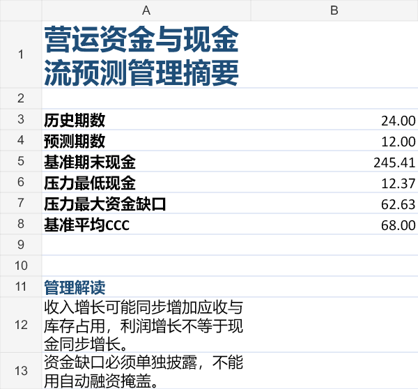

# 营运资金与现金流预测模型

[English](README.en.md) · 中文

[](https://github.com/wangyihanworld-ux/Working-capital-cashflow-forecast-model/actions/workflows/tests.yml)

这是作品集项目五，面向财务BP、FP&A和商业分析岗位。项目使用完全合成的数据，将销售、客户回款、库存采购、供应商付款和经营费用连接到月度现金余额，量化DSO、DIO、DPO和现金转换周期，并识别不同经营情景下的资金缺口。

> 所有企业、客户、供应商、金额和假设均为程序生成，不对应任何真实业务或银行账户。

## 报告预览

下图由一键 Demo 的完全合成数据报告生成，不包含真实业务或银行账户信息。



## 业务问题

- 为什么收入增长时现金仍可能下降？
- 回款放慢、库存目标提高和供应商账期变化分别占用或释放多少现金？
- 压力、基准、增长和改善情景下，未来12个月最低现金余额是多少？
- 何时低于最低现金要求，资金缺口应如何披露？

## 核心模型

- 应收滚动：期初应收 + 收入 - 客户回款 = 期末应收
- 库存滚动：期初库存 + 采购 - 销售成本 = 期末库存
- 应付滚动：期初应付 + 采购 - 供应商付款 = 期末应付
- 现金滚动：期初现金 + 经营现金流 = 期末现金
- 经营现金流：客户回款 - 供应商付款 - 经营费用
- 现金转换周期：DSO + DIO - DPO

## 已实现

- 24个月可重复的合成历史数据和四类12个月预测情景；
- DSO、DIO、DPO驱动的应收、库存和应付滚动；
- 客户回款、采购、供应商付款、经营现金流和现金余额预测；
- 最低现金要求与逐月资金缺口预警；
- 一键输出合成输入文件和含14张工作表的管理报告；
- 20项自动化测试覆盖四套守恒关系、情景方向和输入边界。

## 一键运行

```powershell
python -m pip install -e .
python -m working_capital.demo
```

或运行：

```powershell
working-capital-demo --output-dir .\demo_output
```

## 运行测试

```powershell
python -m unittest discover -s tests -v
```

## 演示结果

压力情景经营现金流为-159.48百万元，最低现金为12.37百万元，最大资金缺口为62.63百万元；基准情景期末现金为245.41百万元；改善情景将平均现金转换周期从68天缩短至40天，期末现金提高到356.48百万元。

## 使用边界

- 情景是假设，不是概率或融资承诺；
- 天数法简化了月内回款和付款分布；
- 未纳入税费、资本开支、债务利息、股利和外汇现金流；
- 合成案例结果不能代表真实企业效果。

详细字段见[数据字典](docs/data-dictionary.md)，实施状态见[项目计划](docs/project-plan.md)。


## 边界处理（2026-10-15）

历史数据须至少12个连续月份；同月不同日会归一化后查重。金额与假设必须有限，增长率不能低于-100%，允许期初现金为负。

库存目标降低时先消耗现存库存，采购下限为0；多余库存继续结转，单列目标库存和超目标库存。不假设供应商退货、报废或现金变现。应收、应付目标分别不超过本期可用余额，以避免负回款和负付款。受约束时实际周转天数可能偏离目标。

零收入、零成本或零采购时，相应周转天数和CCC无定义，在Excel中留空；CCC均值只统计有定义月份。现金与库存勾稽继续计算。30项测试覆盖这些边界。

## Profit-to-cash evidence and model scope

`python -m working_capital.evidence` writes a monthly profit-to-cash bridge and controlled DSO/DIO/DPO sensitivities to `docs/evidence/`. The standard report also includes these two tables.

Under this model's assumptions: operating profit - change in receivables - change in inventory + change in payables = operating cash flow. Operating expenses are entirely cash expenses. Tax, depreciation adjustments, capital expenditure, borrowing and financing repayments are excluded. This is not a complete statutory cash flow statement or three-statement model.

Amounts are millions of the synthetic scenario currency. DSO/DIO/DPO use month-end balances divided by annualized current-month flows; DPO uses purchases, not COGS. These are scenario approximations, not observed invoice settlement times. Minimum-cash shortfall is a threshold gap, not automatically funded debt. Single-driver sensitivities change only one assumption; combined scenarios cannot be attributed solely to CCC.


## 2026年10月26日复核

本轮新增功能、规则来源和适用限制见 [复核记录](docs/review-20261026.md)。实现与自动测试有AI辅助，不能代表本人独立编写、用户试用或企业采用。历史测试数属于当时版本，本轮结果见交付证据。
